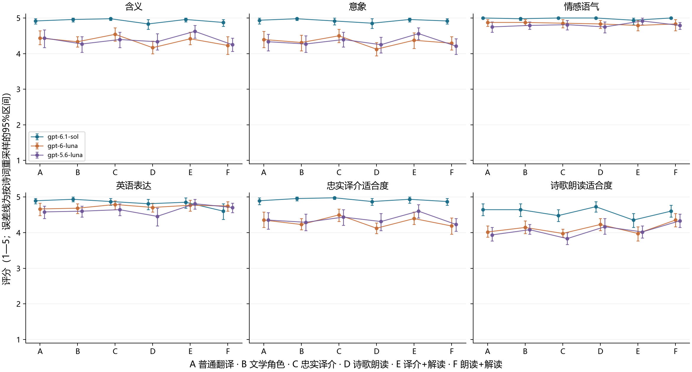
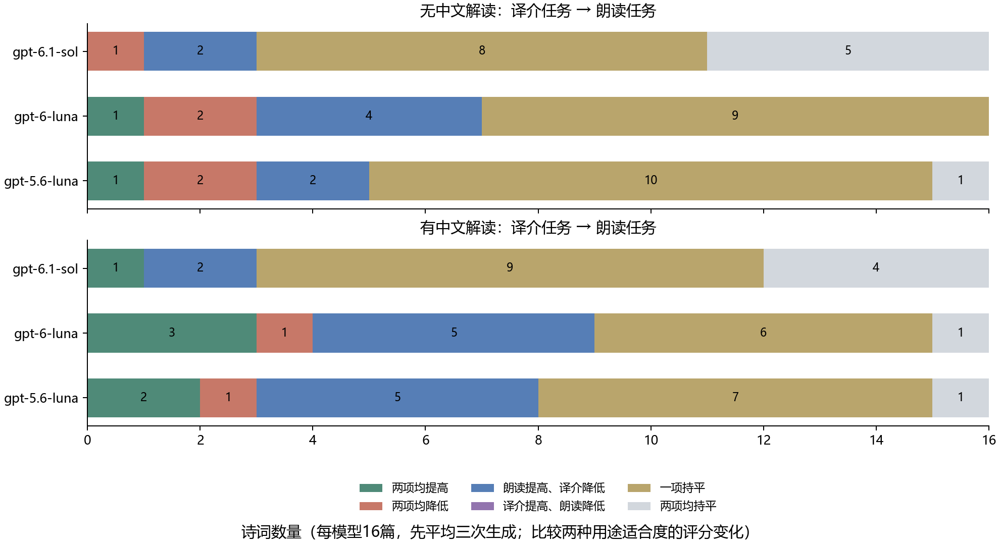
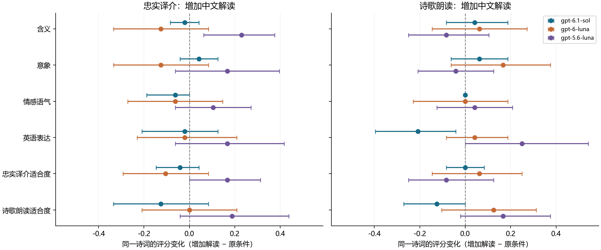

# 翻译目的与语义上下文对诗词英译质量的影响

## 摘要

诗词英译需要同时处理原文含义、文学表达与目标读者的使用需求。本文选取20篇唐诗宋词及片段，以4篇开发材料确定提示与评价格式，在其余16篇上比较普通翻译、文学角色、忠实译介、诗歌朗读及两种增加中文解读的条件。gpt-6.1-sol、gpt-6-luna和gpt-5.6-luna分别重复生成3次，共获得864份正式译文，并进行六维盲评、关键语义单元核对、第二模型复评与顺序敏感性分析。在主评下，朗读任务相对译介任务的诗歌适合度提高0.28分，忠实译介适合度下降0.20分；增加中文解读的跨模型平均收益较小，相关配对区间均跨越零。更换评分模型后，诗歌适合度的平均绝对差达到0.49分，部分提示条件的效果方向发生变化。结果表明，明确翻译目的主要改变表达取舍，补充解读的价值具有模型和文本依赖性；评价应结合多维结果、具体译句及评分尺度，避免以流畅程度或单一分数判定最优译法。

## 1 引言

诗词英译同时涉及语义解释与目标语言表达。杜牧“多情却似总无情”中的情绪反差、柳永“竟无语凝噎”中的失语状态，以及姜夔“废池乔木，犹厌言兵”中的拟人关系，都难以用英语是否流畅来充分评价。一份译文可以句法自然，却把悲凉写成平静，或把原作保留的关系补写为确定的故事。相反，为保存原句结构而形成的译文，也可能缺少英语诗歌的节奏。

翻译目的理论强调，受众与使用目的参与决定翻译策略[1]。对于大语言模型，这些要求可以具体写成提示条件：读者是否了解中文，译文用于解释原作还是英语朗读，哪些信息可以放入注释，以及是否允许重新安排句式和诗行。本实验进一步考察中文语义解读的作用：它既可能帮助模型理解情绪转折和意象关系，也可能使译文过度解释、缩小原作的多义空间。

本文设置六种提示条件，在三个模型上对相同诗词重复生成译文，研究三个问题：第一，明确翻译用途后，译文的含义、意象与英语表达如何变化；第二，在用途固定时，补充中文解读能否改善翻译质量；第三，同一译文在忠实译介与英语诗歌朗读两种评价目标下，是否呈现不同的优势。评价采用分维度评分、关键语义单元核对及原文—译文案例分析，避免将所有用途压缩为单一总分。

## 2 语料与实验材料

语料选取20篇唐诗宋词及连续片段，唐诗与宋词各10篇，每篇约20—60个汉字。原文依据维基文库收录的作品或古籍总集逐句核对，繁体来源统一转换为简体，异文采用对应来源的主读。作者、篇名、来源链接、选段及异文说明保存于语料文件中[5]。样本覆盖情绪反转、拟人、意象并置、时序切换、文化指称和主语省略，采用目的性选样。

**表1 语料划分与正式测试作品**

| 体裁 | 开发集（各2篇） | 正式测试集（各8篇） |
|---|---|---|
| 唐诗 | 杜牧《赠别二首·其二》；李商隐《夜雨寄北》 | 李白《玉阶怨》《独坐敬亭山》；杜甫《江南逢李龟年》；韦应物《滁州西涧》；温庭筠《商山早行》；李贺《南园十三首·其五》；王昌龄《闺怨》；刘禹锡《乌衣巷》 |
| 宋词 | 苏轼《江城子·乙卯正月二十日夜记梦》片段；晏殊《浣溪沙·一曲新词酒一杯》 | 柳永《雨霖铃》、辛弃疾《摸鱼儿·更能消》、周邦彦《苏幕遮·燎沉香》、姜夔《扬州慢》、苏轼《定风波·莫听穿林打叶声》、欧阳修《蝶恋花·庭院深深深几许》的连续片段，以及秦观《鹊桥仙·七夕》、李清照《一剪梅·红藕香残玉簟秋》 |

开发集用于确定提示与评分格式，正式分析使用其余16篇，且每篇的全部条件、模型与重复生成均保留在同一划分中。生成输入提供所选中文正文，不附作者、篇名或现成英文译本，减少题名与参考译文带来的额外提示。

每篇材料另设一段中文语义解读，以及3—4个关键语义单元。正式测试共61个单元，用于定位应当保留的内容，例如《江南逢李龟年》中的昔日相识与今日重逢、《闺怨》中由无愁转为后悔的变化。这些解释由本实验制定，尽量保留原文允许的多解；合理补入英语语法所需的主语不直接计为错误，新增身份、关系或事件则需有原文依据。语义解读仅提供给指定生成条件，关键单元提供给所有译文的评价过程。

## 3 方法与提示条件

### 3.1 条件生成与上下文作用

自回归语言模型根据已有上下文逐词元生成文本。令原诗为 x，任务要求为 p，补充解读为 c，译文为 y，则生成可表示为：

$$
\begin{gathered}
P_\theta(y\mid x,p,c)\\
=\prod_{t=1}^{T}P_\theta(y_t\mid y_{<t},x,p,c).
\end{gathered}
$$

其中，θ 为模型参数，T 为输出长度。本文改变任务要求和语义上下文，模型参数保持固定。用途要求影响表达选择，中文解读则提供关于原文含义与关系的额外条件，两者可能共同改变候选译句的生成概率。

自注意力为理解这种上下文依赖提供了基本机制[2]。输入词元经嵌入及位置信息表示后，映射为查询 Q、键 K 和值 V；单个注意力头的计算形式为：

$$
\begin{gathered}
\operatorname{Attention}(Q,K,V)\\
=\operatorname{softmax}\!\left(\frac{QK^{\mathsf T}}{\sqrt{d_k}}+M\right)V.
\end{gathered}
$$

d_k 为键向量维数，M 为自回归生成所需的因果掩码。多头机制并行形成不同关系表示，前馈网络、残差连接及归一化进一步加工这些表示。这里采用语言模型与自注意力的通用形式说明提示如何参与生成；实验比较的对象是提示条件对最终译文的作用。

### 3.2 六种提示条件

所有条件共用相同输出约束：保留核心含义、意象与情感方向，不增写事实；英文译文不超过120词，可附0—2条简短注释，注释总计不超过60词。输出分为译文与注释两个字段。随后加入表2中的条件指令，E和F再加入同一段中文语义解读。

**表2 提示条件与比较关系**

| 条件 | 任务要求 | 中文解读 | 主要比较用途 |
|---|---|---|---|
| A 普通翻译 | 将给定中文诗词译为英文 | 无 | 基准条件 |
| B 文学角色 | 扮演文学译者，表达自然、有诗意，保留原文内容 | 无 | 观察角色与风格要求的组合变化 |
| C 忠实译介 | 面向不懂中文的英语读者，保留含义、意象与语气；必要背景可用简注 | 无 | 明确译介用途 |
| D 诗歌朗读 | 面向英语诗歌朗读，可调整节奏、重组诗行，保持核心含义与情感方向 | 无 | 明确朗读用途与改写权限 |
| E 译介＋解读 | C的全部要求，并提供中文语义解读 | 有 | 与C配对，考察译介条件下的上下文作用 |
| F 朗读＋解读 | D的全部要求，并提供同一段中文语义解读 | 有 | 与D配对，考察朗读条件下的上下文作用 |

E−C与F−D保持对应的用途要求一致，主要变化是提供语义解读及其使用说明。A与B同时改变角色和风格要求，C与D同时改变受众用途及表达权限，因此这些比较反映整组任务要求的作用。实验解释不将组合条件的差异进一步归因为其中某一个词或单独的角色设定。

### 3.3 分维度盲评与关键单元核对

机器翻译评价需要把质量判断落实到具体内容和错误证据[3]。本文据诗词任务制定六个1—5分维度：1分表示严重缺失或失真，3分表示基本传达但有明显问题，5分表示该维度准确或表现充分，2分和4分作为中间等级。

**表3 评价维度**

| 维度 | 观察重点 |
|---|---|
| 含义 | 原句含义与关系是否准确、完整 |
| 意象 | 景物、动作与比喻是否保留且表达清楚 |
| 情感语气 | 感情方向、强度及语体是否合适 |
| 英语表达 | 语法、习惯表达与流畅性 |
| 忠实译介适合度 | 英语读者能否借译文和必要简注理解原作 |
| 诗歌朗读适合度 | 依据书面译文判断英语诗歌的节奏、诗行与表达效果 |

每份译文同时获得两种用途适合度评分，无论生成时采用哪一种用途。注释只参与忠实译介适合度的判断，不能替代译文本身在其他维度中应传达的内容。关键单元分别标记为完整传达、部分传达、缺失或错误，并附译文中的原句证据及解释。程序核对证据引文是否确实来自对应输出，匹配时只归一化排版空白与大小写，保留词语和标点。同一批次保留最早通过统一格式与出处核验的评分，原始响应全部保存。引文匹配只保证出处，语义判断仍需结合原诗和案例检查。

主评模型为gpt-6.1-sol。对于同一诗词的同一次重复，将3个模型、6个条件产生的18份译文混洗，每6份组成一个评价批次。评分输入包含原诗、关键单元及匿名译文，不提供生成模型、提示条件或生成指令。为考察模型评分的敏感性，另以gpt-5.6-luna复评全部16篇的第一次生成结果，并将排序最前的4篇测试作品之第一次生成结果交由主评模型按批内逆序复评。这4篇均为宋词，逆序结果仅代表该子集。模型评价可能具有位置、风格和自偏好，匿名与复评用于观察这些影响[4]。

## 4 实验设置与统计方法

### 4.1 模型与生成参数

实验采用gpt-6.1-sol、gpt-6-luna和gpt-5.6-luna。每个模型对16篇测试诗词、6种条件各生成3次，共864份正式译文；每个模型对应288份。所有正式生成使用相同冻结提示和任务清单。

**表4 生成与评价设置**

| 项目 | 设置 |
|---|---|
| 生成模型 | gpt-6.1-sol、gpt-6-luna、gpt-5.6-luna |
| 推理强度 | low |
| 生成长度上限 | 2048 completion tokens |
| 评价长度上限 | 8192 completion tokens |
| 温度与top-p | 未显式设置，沿用服务默认值 |
| 正式生成规模 | 16篇×6条件×3模型×3次＝864份 |
| 主评规模 | 144批，每批6份，共864份 |
| 第二模型复评 | 16篇的第一次生成，共288份 |
| 逆序复评 | 4篇宋词的第一次生成，共72份 |
| 区间估计 | 按诗词重采样2000次，报告95%百分位区间 |

每次响应保留原文。格式解析仅进行去除代码围栏、读取字符串中换行等机械处理，不改写译文。符合字段结构但违反字数或注释限制的输出仍进入评价，并记录约束违反。仅调用异常、截断或无法解析的结果允许有限重试；译文质量和评分不作为重新生成的依据。

### 4.2 配对统计

各条件首先在同一诗词、同一模型内部对3次生成评分求均值，再对16篇诗词求均值。比较条件时先计算同诗词的配对差值。以增加解读的E−C为例：

$$
\begin{gathered}
\Delta_m^{E-C}=\frac{1}{N}\sum_{i=1}^{N}\left(\bar{s}_{i,m,E}-\bar{s}_{i,m,C}\right),\\
N=16.
\end{gathered}
$$

其中，s̄为指定维度的重复生成平均分，m为生成模型。跨模型汇总同样先在每篇诗词内平均模型结果，再对诗词求均值。重采样以诗词为单位，保留其内部的模型、条件和重复结构，避免把864份译文当作864篇独立作品。1—5分的平均值用于描述该评价协议下的相对表现，区间反映所选作品间的波动。

### 4.3 代码与复现

代码、中文语料、完整提示、原始译文、评分及绘图程序归档于[实验仓库](https://github.com/stq1234/LLMandAppliedPractices-Classical-Poetry-Translation)。本次实验的代码及相关说明可在该仓库中获取。

复现分为重新分析与重新生成两种方式：前者直接读取归档译文和评分，重新计算统计量并绘图；后者先配置模型服务及环境变量`OPENAI_API_KEY`，再依次执行任务准备、生成、主评、两组复评和汇总。访问密钥由运行环境提供，具体安装与执行命令见仓库README。重新生成可能因采样及服务端模型状态产生不同译文，归档原始结果用于复核本文数值。

## 5 实验结果

### 5.1 三个模型的整体表现

864份正式译文均进入主评，第二模型和逆序复评分别覆盖288份与72份。表5汇总各生成模型在六种条件及三次重复上的表现，图1进一步分解到具体提示条件。所有分数均为1—5分，表中数值按第4.2节的层级顺序平均。

**表5 各生成模型的六维平均分（主评模型：gpt-6.1-sol）**

| 生成模型 | 含义 | 意象 | 情感语气 | 英语表达 | 忠实译介 | 诗歌朗读 |
|---|---:|---:|---:|---:|---:|---:|
| gpt-6.1-sol | 4.92 | 4.93 | 4.99 | 4.83 | 4.92 | 4.58 |
| gpt-6-luna | 4.35 | 4.33 | 4.84 | 4.73 | 4.30 | 4.12 |
| gpt-5.6-luna | 4.39 | 4.34 | 4.80 | 4.64 | 4.37 | 4.06 |

**图1 六种提示条件下的分维度评分。** 每个点先平均同一诗词的3次生成，再平均16篇诗词；误差线为按诗词重采样的95%区间。A—F定义见表2，纵轴保留完整1—5分尺度。

主评对gpt-6.1-sol的评分整体较高，其情感语气接近上限。两个Luna模型的英语表达均高于其含义和意象评分，说明语句流畅与原文关系准确并非同一性质。gpt-6-luna在英语表达和朗读适合度上略高于gpt-5.6-luna，后者在含义和忠实译介上略高；这种细小差别需要结合复评判断，不能直接推广为模型的一般能力排序。

仅加入文学角色和诗意风格要求的B条件，相对A的朗读适合度平均提高0.09分，95%区间为[−0.06, 0.23]；含义变化为−0.08分，区间为[−0.20, 0.04]。在本语料和共用约束下，这组角色与风格要求未形成明确的整体优势。

### 5.2 改变用途带来的质量取舍

从C的忠实译介转向D的诗歌朗读，主评中的朗读适合度由4.10提高到4.38，忠实译介适合度由4.64降至4.44；含义和意象也分别下降约0.19分。表6给出同诗词的配对差异，避免将不同材料的难度混入条件比较。

**表6 主要条件的跨模型配对差异（平均变化及95%区间）**

| 条件比较 | 含义 | 忠实译介适合度 | 诗歌朗读适合度 |
|---|---:|---:|---:|
| D−C：译介改为朗读 | −0.19 [−0.36, −0.03] | −0.20 [−0.34, −0.07] | +0.28 [+0.15, +0.42] |
| E−C：译介增加解读 | +0.03 [−0.06, +0.12] | +0.01 [−0.08, +0.10] | +0.02 [−0.15, +0.16] |
| F−D：朗读增加解读 | +0.01 [−0.09, +0.11] | −0.01 [−0.11, +0.10] | +0.06 [−0.07, +0.18] |

图2进一步检查两种用途评分如何共同变化。没有中文解读时，48个诗词—模型组合中有8个出现“朗读提高、译介降低”；有中文解读时为12个。这里的48个组合来自16篇诗词与3个模型，每个组合内部先平均3次生成，并非48篇独立作品。多数其余组合在至少一个评价目标上持平，因此平均层面的取舍不能理解为每首作品必然一升一降。

**图2 从译介任务转向朗读任务后的评分变化类型。** 上图为D−C，下图为F−E；每条横条包含同一模型的16篇诗词，数字为对应作品数。“一项持平”表示另一项发生变化，“两项均持平”单独统计。

### 5.3 中文语义解读的作用

表6显示，增加中文解读后的跨模型平均变化较小；E−C与F−D在全部六个维度的95%区间均包含零。结果不支持“提供一段解释就会普遍提高翻译质量”的判断。

**图3 增加中文解读后的配对评分变化。** 左图为E−C，右图为F−D；点为16篇诗词的平均差值，横线为按诗词重采样的95%区间，虚线为零变化。

模型内部的反应并不一致。图3中，gpt-5.6-luna在译介条件下的含义平均提高0.23分，gpt-6-luna则下降0.13分，gpt-6.1-sol变化接近零。后者在朗读条件下加入解读后，英语表达评分下降约0.21分。它们提示解读并非单向增益：信息约束可能帮助某些译文明确关系，也可能干扰原有表达或鼓励解释性措辞。单个模型和维度的差异仍应结合多重比较、复评及具体译句理解，不将局部区间单独视为普遍规律。

### 5.4 对评分模型与呈现顺序的敏感性

表7在相同译文上比较两次评分。第二模型复评使用16篇诗词的第一次生成，共288份；逆序复评使用4篇宋词的第一次生成，共72份。平均绝对差衡量评分移动的幅度，完全一致率衡量两次给出同一整数分数的比例。

**表7 评分敏感性：平均绝对差（分）／完全一致率**

| 维度 | 更换评分模型（288份） | 批内顺序反转（72份） |
|---|---:|---:|
| 含义 | 0.30／70.8% | 0.08／91.7% |
| 意象 | 0.32／69.1% | 0.17／83.3% |
| 情感语气 | 0.19／81.2% | 0.07／93.1% |
| 英语表达 | 0.25／75.7% | 0.14／86.1% |
| 忠实译介适合度 | 0.29／71.9% | 0.10／90.3% |
| 诗歌朗读适合度 | 0.49／52.8% | 0.14／86.1% |

在所测子集中，更换评分模型带来的差异大于仅改变批内顺序，尤其集中于朗读适合度。在共同的第一次生成结果上，D−C的朗读变化由主评的+0.23分变为第二模型的0.00分，忠实译介变化则从−0.19分变为−0.40分。两者均观察到忠实译介下降，但对诗歌表达是否获得收益的判断不同。E−C的忠实译介变化也从+0.06分变为−0.27分，因此上下文增益的解释对评分模型敏感。

gpt-6.1-sol在两套评分下的平均分仍较高，但两个Luna模型的相对位置随维度和评分模型变化。这些结果支持在模型评分中保留分维度与敏感性分析，而不把主评的一个平均分直接视为统一审美标准。逆序差异还包含重新评分的随机波动，不能全部归因为位置本身。

## 6 译文案例分析

以下案例围绕语义具体化、时序关系及表达取舍选取，使用同一模型、同一次重复中的配对输出。它们用于解释变化类型；条件的总体趋势由全部正式结果判断。

### 6.1 《商山早行》：纠正一处具体化，同时引入另一处取舍

原句为“因思杜陵梦，凫雁满回塘”。gpt-6-luna的第二次生成在C条件下使用“Then I recall my dream of Duling”，并将末句处理为“Fill the pond I long to return to”。E条件则为“And so I dream of Duling”及“ducks and geese fill the winding pond”。

C把“回塘”写成“我渴望返回的池塘”，增加了原句未明说的思念对象；E的“winding pond”采用曲折池塘的读法，避免了这层补写。但E同时将“思梦”改成“dream”，弱化了回想梦境与正在做梦的区别。主评对这两个版本的含义均给4分，对意象分别给4分和5分，并将E的相关梦境单元标为部分传达。评分理由能够定位问题，但原句的梦境时态仍存在解释空间。补充解读在此改变了若干局部选择，无法概括为整首译文全面变好。

### 6.2 《扬州慢》：朗读的紧凑与关系信息的保留

原句为“自胡马窥江去后，废池乔木，犹厌言兵”。gpt-5.6-luna的第二次生成在C条件下写道：

> Ever since the northern cavalry came probing across the river and withdrew,  
> the ruined pools and towering trees still shrink from speaking of war.

D条件为：

> Since the war-horses came probing the river,  
> these ruined pools, these towering trees  
> still loathe to speak of war.

D通过短句与“these”的重复形成朗读节奏，并保留了池木厌战的拟人；但“去后”中的离去关系没有明确表达。C的“and withdrew”保留了这一时序，又用“across the river”将“窥江”具体化为跨江方向，比原词更加确定。两个版本的差别说明，表达紧凑、关系完整和解释克制是可以分别检查的性质。仅判断哪个版本更流畅，会掩盖这些不同层面的得失。

### 6.3 《鹊桥仙》：解读改变措辞，并不稳定产生新的理解

gpt-6.1-sol第一次生成对“柔情似水，佳期如梦，忍顾鹊桥归路”的C版本使用“Their time together is a dream”和“look toward the magpie bridge”；E版本使用“Their tryst is like a dream”和“look back at the magpie bridge”。E明确表达“如”的比较及“顾”的回望，C则使用更宽泛的时光与方向表达，两者都保留了短暂相会、如梦和不忍归去的主要关系。

同一模型第三次生成时，C已经使用“their precious tryst is like a dream”和“look back”，E在相应位置反而使用“the precious meeting is a dream”。这组重复结果提示：一次配对中更贴近字面结构的措辞，也可能在没有额外解读的条件下自然出现；“is a dream”与“like a dream”分别采取隐喻和明喻表达，也不能直接等同于错误和正确。中文解读更适合用于约束易误解的关系，而非保证每次生成都按固定措辞改善。

## 7 讨论

本实验将翻译场景落实为受众、用途、注释权限和表达自由度，并把语义解读作为可单独比较的输入条件。这样的任务约定比只指定“有诗意”更便于解释译文为什么变化：朗读任务可以重点检查节奏与分行，忠实译介任务则应检查读者是否能准确理解原文及文化指称。两种任务仍共享含义与情感约束，因此允许改写并不意味着可以忽略人物关系、时序或拟人对象。

中文解读的价值取决于它补充了什么。对于模型已经熟悉的意象和句式，重复解释可能主要改变措辞；对于容易具体化或混淆的关系，解释可以提供约束，但也可能使某一种读法获得更高权重。本实验的语义解读与评价单元来自同一套原文分析，因而评价更敏感于这些指定关系。对这些关系的贴合不等同于涵盖作品的全部文学解释，尤其需要谨慎处理主语省略、典故和比喻指向。

模型评分提供了可重复的比较工具，其尺度仍受到评分模型的偏好影响。主评模型同时参与译文生成，匿名处理不能完全消除其风格偏好；第二模型复评也来自同一模型系列。顺序复评仅覆盖4篇宋词，五级评分还可能将细小表达差异压缩为相同分数。因此，数值结果应与具体译句共同解释，不能直接当作专业译者的审美共识。

语料为目的性选择的经典名篇或短片段，模型可能已在预训练中接触相关内容。结果主要反映这些材料在不同提示下的解释与表达变化，对生僻作品、长篇叙事或严格格律翻译的适用性有限。短片段有利于控制输入范围，却弱化了整首作品结构、历史语境及跨段照应对翻译的影响；这些是本方法在覆盖范围与可控比较之间的权衡。

## 8 结论

在三模型、六条件、864份译文的比较中，明确翻译用途能够改变诗词英译的质量取舍。主评下，朗读任务提高了诗歌适合度，同时降低忠实译介、含义和意象评分；用途要求应与相应评价目标配套，不能仅凭流畅或诗意判定译文更好。

中文语义解读没有带来稳定的跨模型平均提升，其作用随模型和文本关系而变化。具体案例显示，它可以减少部分无依据的具体化，也可能改变时态、措辞或解释范围。设计提示时，应优先明确容易误解的关系与允许的改写边界，再检验这些补充是否对目标用途有帮助。

模型评分的尺度差异也是实验结果的一部分。第二评分模型对诗歌收益的判断与主评不同，因此较可靠的结论是：任务条件改变了表达选择，译介与朗读目标存在可观察的取舍，而不存在由本实验支持、适用于所有用途和读者的单一最佳提示。

## 参考文献

[1] Reiss, K., & Vermeer, H. J. *Towards a General Theory of Translational Action: Skopos Theory Explained*. English translation, 2013; German original, 1984. [出版社页面](https://www.routledge.com/Towards-a-GeneralTheory-of-Translational-Action-Skopos-TheoryExplained/Reiss-Vermeer/p/book/9781905763955).

[2] Vaswani, A., et al. 2017. *Attention Is All You Need*. NeurIPS. [论文](https://arxiv.org/abs/1706.03762).

[3] Freitag, M., et al. 2021. *Experts, Errors, and Context: A Large-Scale Study of Human Evaluation for Machine Translation*. Transactions of the Association for Computational Linguistics, 9, 1460–1474. [论文](https://aclanthology.org/2021.tacl-1.87/).

[4] Zheng, L., et al. 2023. *Judging LLM-as-a-Judge with MT-Bench and Chatbot Arena*. NeurIPS Datasets and Benchmarks. [论文](https://arxiv.org/abs/2306.05685).

[5] 维基文库所收唐诗宋词正文及古籍卷页，包括[《赠别二首》](https://zh.wikisource.org/zh-hans/贈別二首_(杜牧))、[《商山早行》](https://zh.wikisource.org/zh/商山早行)、[《扬州慢》](https://zh.wikisource.org/zh-hans/揚州慢)、[《鹊桥仙》](https://zh.wikisource.org/zh-hans/鹊桥仙_(秦观))等。全部20篇的原文来源与选段说明见[语料来源文档](https://github.com/stq1234/LLMandAppliedPractices-Classical-Poetry-Translation/blob/main/data/corpus_sources.md)。
